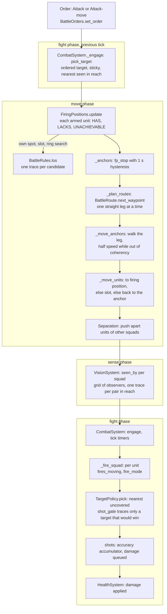
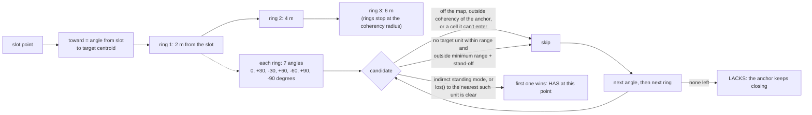
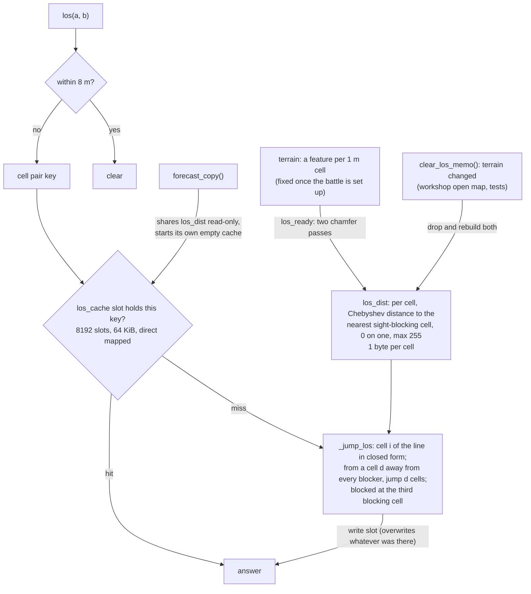

# Firing positions and line of sight: from an order to a shot

Written 2026-11-28 for the owner, after sw-arse (line of sight at scale). It explains how a unit gets from an
attack order to a shot, where each step lives in the code and which tests hold it, what line of sight is built on
now, and what it all costs as battles grow. GDD: `02 Rules Spec.md` §2.6 (range, vision, line of fire), §2.14
(battle space, routing, separation, coherency) and §2.15 (orders, firing positions).

## 1. In short

An attack order doesn't tell units where to stand. It names an enemy (Attack) or a point to fight toward
(Attack-move). Each tick the squad's combat pass picks the enemy squad it engages, and from the next tick every
armed unit of the squad looks for its own **firing position**: a point within the squad's **coherency radius** of
the anchor (the squad's formation centre) from which it has a shot at some unit of that enemy squad. "A shot" is
the same gate the fire pass uses: in range, outside minimum range, and a clear line of sight (or an indirect fire
mode). The unit walks there, stops, and fires as its own weapon timers allow, so a squad's first volley comes out
staggered as each unit gets its shot. The anchor keeps walking along its route while any unit still lacks a
position, and stops once all of them have one.

Line of sight is a walk along the grid line between the two cells: it is blocked when more than two cells strictly
between them block sight (forest, ruins, walls), and never blocked within 8 m. Four systems ask it: firing
positions (one trace per candidate point), vision (squad centroid to squad centroid), the fire pass (unit to unit,
for every target it considers) and the read models (LineOfFire, BattleActivity).

What sw-arse found: line of sight was never most of the cost, at any battle size. What grew badly with battle
size was vision's pair loop, which read two stats for every pair of squads every tick: 24 of 54 ms per tick at
160 squads. What sw-arse built, all exact (same answer for every query, same state hash on every battle):

1. **A jump walk** over a per-cell distance field: the walk's cells have a closed form, so it jumps over open
   ground instead of stepping cell by cell: 3-10 times faster than the plain walk, and with the cache 2.7-7 times
   faster than the memo it replaces.
2. **A bounded answer cache** (64 KiB per battle) in place of the dictionary memo, which could grow to 2^18
   entries per battle.
3. **Vision through a grid**: each squad tests only observers that could reach it, with their stats read once per
   tick. 10 times cheaper at 160 squads.
4. **The fire pass traces less**: a target is traced only if it would beat the best target found so far.

A 160-squad battle-tick went from 53.2 ms to 31.7 ms (40 squads: 7.6 to 6.5), and cost now grows about linearly
with squads (4.9 times the cost for 4 times the squads, against 7.0 times before). Several battles cost exactly the sum of their parts,
before and after: they share nothing. Line of sight is now 0.3% of a 160-squad tick (0.08 ms). What dominates now is per-unit
GDScript work in movement and combat (follow-ups in §8).

## 2. From an order to a shot, per tick

The battle runs five phases per tick, in a fixed order (`src/sim/battle/battle_sim.gd:12`): effects, **move**
(centroids, then MovementSystem: firing positions, routes, anchors, units, separation), **sense** (centroids,
vision, reactions), **fight** (CombatSystem, then HealthSystem) and pressure. Firing positions run before the
anchors move and read the engagement the fight phase chose on the tick before.

### 2.1 Orders and engagement

- **The order.** `BattleOrders.set_order` (`src/sim/battle/battle_orders.gd:111`) sets the squad's order, its point
  or target and the run flag. Attack-move fights what it meets on the way to a point; Attack follows one squad.
- **Engagement.** Each tick `CombatSystem._engage` (`src/sim/battle/combat_system.gd:146`) asks
  `pick_target` (`:52`): the ordered target if the side sees it and it is in reach, else the previous target while
  it stays valid, else the nearest seen enemy in reach. "In reach" (`in_reach`, `:85`) means some living armed unit
  of the squad has some living unit of the other squad within its weapon range, unit to unit, after a centroid
  broadphase. So a squad engages as its first unit comes into range.
- Tests: `tests/sim/test_target_policy.gd` (`test_pick_target_matches_engagement_nearest`,
  `test_pick_target_honours_attack_order`).

### 2.2 The anchor and coherency

- **The anchor** is the squad's formation centre; units steer to formation slots around it. Under an attack order
  `_destination` (`src/sim/battle/movement_system.gd:187`) decides where it walks: along the route to the point, then
  toward the engaged squad within the chase leash (15 m past the point for Attack-move; none for Attack); it stands
  while `_holds` says every armed unit has its firing position (`fp_stop`, below).
- **Coherency radius** (`coherency_m`, `:161`; data per formation, the default the formation's half-width plus 4 m):
  how far a unit may be from the anchor. A unit beyond it heads straight back to the anchor, and the anchor walks at
  half speed while any unit is out (`out_of_coherency`, `:167`, used in `_move_anchors`, `:100`).
- **Stop and restart** (`FiringPositions._anchors`, `src/sim/battle/firing_positions.gd:297`): the anchor stops
  (`fp_stop = 1`) once no armed unit lacks a position. Once stopped it moves again only after some unit has lacked a
  position for the behaviour's hysteresis (1 s), so a position that flickers doesn't restart the squad.
- Tests: `tests/sim/test_coherency.gd` (`test_anchor_runs_at_half_speed_while_a_unit_is_out_of_coherency`,
  `test_squad_routed_round_a_corner_keeps_every_unit_in_coherency`); `tests/sim/test_firing_positions.gd`
  (`test_hysteresis_restarts_only_after_one_second`, `test_flicker_does_not_restart_the_anchor`,
  `test_attack_move_keeps_its_leash_past_the_point`, `test_attack_has_no_leash`).

### 2.3 The firing-position search

`FiringPositions.update` (`src/sim/battle/firing_positions.gd:160`) runs first in the move phase. For each squad
that engages for positions (`_engaging_rows`, `:114`: Attack-move with an engaged squad, or Attack on its target;
the engaged squad must be seen by the side), each living armed unit gets a code:

- **HAS**: it holds a firing position (`fx`, `fy`). A unit holding one re-checks only that point, every 5 ticks
  (staggered by unit), and skips even that if it fired within the cadence.
- **LACKS**: it has none yet; it walks with its slot and holds the anchor.
- **UNACHIEVABLE**: no point inside coherency can work (no standing fire mode, or every target unit is inside its
  minimum range plus the stand-off). It doesn't hold the anchor.
- **NONE**: not evaluated, or the order no longer engages (it returns to its slot).

A unit's first evaluation (`_evaluate`, `:332`) tries its own spot (if inside coherency), then its slot, and runs
uncapped, so a squad that engages standing doesn't step forward first. If both fail and the unit isn't too far for
any ring to reach (slot farther than range + coherency + 10 m from the target centroid), it is due a **ring search**
(`_search`, `:393`):

Before any candidate it checks, exactly, that some target unit is within range + coherency of the anchor; if none
is, every candidate must fail and it returns LACKS without tracing. Budgets per battle per tick: at most
`SEARCH_CAP = 2` ring searches and `EVAL_CAP = 3` re-evaluations of units that lack a position or can't have one,
each taken from its list rotated by the tick (stateless round robin). A deferred unit keeps its code until a later
tick picks it.

- A shot from a point (`_shot`, `:562`; the public form is `point_shot`, `:507`): the nearest living target unit
  by squared distance that is within range and outside minimum range plus stand-off; any one for an indirect
  standing mode, else one `los()` trace to that nearest unit.
- Tests: `tests/sim/test_firing_positions.gd` (`test_assault_attack_move_walks_its_shotguns_in_within_coherency`,
  `test_mortar_inside_min_range_backs_out_to_the_band`, `test_mortar_attack_move_never_comes_inside_20_m`,
  `test_staggered_opening_and_no_unit_waits`, `test_hold_never_leaves_slots`, `test_engaging_rows_matches_engaging`).

### 2.4 Line of sight

`BattleRules.los(ax, ay, bx, by)` (`src/sim/battle/battle_rules.gd:443`) takes two fixed-point points:

1. Within 8 m (`AWARENESS`) it is always clear: an exact squared-distance test, no square root.
2. Both points go to their cells (clamped to the map).
3. The answer cache is checked (§3).
4. Otherwise `_jump_los` (`:473`) answers, which gives exactly what the reference walk `_walk_los` (`:509`) gives:
   walk the grid line between the two cells; blocked once more than `LOS_DEPTH = 2` cells strictly between them
   block sight, so squads see a little way into and out of forests and ruins (R3Q8, R8Q1).

Who asks, per tick (measured on the 40-squad fixture, §4): the fire pass about 70% of traces (unit to every target
unit it considers), vision about 20% (squad centroid to centroid), firing positions about 12%. `LineOfFire`
(`src/sim/battle/line_of_fire.gd:15`, `:32`, `:47`), `BattleActivity` and the workshop ask it outside the tick, for
the read models.

### 2.5 Routing and separation

- **Routes** (GDD §2.14 Routing): `_plan_routes` (`src/sim/battle/movement_system.gd:43`) gives every walking squad
  a leg from `BattleRoute.next_waypoint` (`src/sim/battle/battle_route.gd:66`): the farthest point on the cheapest
  cell path the anchor can walk straight to at no more cost. Plans are cached per map, never saved. An attacker
  re-plans when its target has moved more than 8 m from where the route was planned to.
- **Units** (`_move_units`, `:328`) steer to their firing position if they hold one, else their formation slot, else
  (beyond coherency) the anchor. They never enter a cell their movement type can't; they slide along walls.
- **Separation** (`src/sim/battle/separation.gd:57`): after units step, a unit closer than its separation radius to a
  unit of another squad is pushed apart, half the overlap each, through a 2 m spatial hash. No body blocking.
- Tests: `tests/sim/test_battle_route.gd` (`test_a_squad_walks_round_a_wall`,
  `test_an_attacker_plans_again_only_when_its_target_has_moved_far`,
  `test_units_never_enter_a_wall_while_the_squad_skirts_it`), `tests/sim/test_separation.gd`
  (`test_two_squads_on_one_point_end_apart_by_size_class`, `test_head_on_walkers_step_around_each_other`).

### 2.6 Vision

`VisionSystem` (`src/sim/battle/vision_system.gd:40`) sets each squad's `seen_by` bits: an enemy squad sees it when
the centroids are within the observer's sight (shrunk by the target's concealment, or the observer's detection
radius scaled by its Instinct when the target is concealed) and `los()` between the centroids is clear. Fog
(`seen_by`) gates engagement and firing positions. Since sw-arse it reads each observer's sight and detection once
per tick and buckets observers in a grid whose cells are as wide as the longest reach, so a squad tests only
observers in the 3 x 3 cells around it (§3.3). Tests: `tests/sim/test_los_scale.gd`
(`test_vision_grid_matches_the_pair_rule`), concealment and detection tests in `tests/sim/test_battle_rules.gd`.

### 2.7 The volley phase and the fire pass

`CombatSystem.run` (`src/sim/battle/combat_system.gd:32`): engage every squad, tick every unit's reload and cooldown
(`_tick_timers`, `:259`), then `_fire_squad` (`:173`) for each engaged squad. Per living armed unit:

- **Moving or standing** (`fires_moving`, `:115`): a unit that moved this tick fires its moving mode, unless it is
  under an attack order without a held position and has a standing shot from where it now stands (it arrived: it
  fires standing, U1Q28). `fire_mode` (`:135`) picks the mode; a behaviour may forbid fire on the move.
- **Ready**: reload and cooldown at 0. Each unit fires on its own timers, so volleys stay staggered.
- **Target** (`TargetPolicy.pick`, `src/sim/battle/target_policy.gd:17`): the nearest living target unit that passes
  `shot_gate` (`combat_system.gd:285`: range, minimum range, line of sight unless indirect), preferring units whose
  queued damage doesn't already cover their HP. Since sw-arse the gate runs only for a target nearer than the best so
  far, which picks the same unit with fewer traces.
- **Shots**: per shot an accuracy accumulator decides the hit (deterministic, no RNG roll), damage is queued with
  `Health.queue` and applied by HealthSystem after the fight phase.
- Tests: `tests/sim/test_arrival_fire.gd` (`test_arrival_tick_fires_standing_not_moving`,
  `test_coming_into_range_fires_first_shot_standing`, `test_walking_unit_still_fires_on_the_move`),
  `tests/sim/test_line_of_fire.gd`.

## 3. The line-of-sight structure (sw-arse)

### 3.1 The jump walk

The reference walk steps along the grid line between the two cells, one cell per step along the line's major axis.
Its i-th cell has a closed form. With a = |dx| ≥ b = |dy| it is (x0 + sx·i, y0 + sy·⌊(2bi + a) / 2a⌋), and the same
with the axes swapped when b > a, ties included (`test_walk_cells_have_a_closed_form` checks every direction and
offset up to 48 cells against the walk). Cells i and i + k of a line are exactly k apart in Chebyshev distance (the
major axis moves k). So if cell i is d cells from every blocker (`los_dist`), cells i + 1 to i + d - 1 can't block,
and the walk jumps straight to cell i + d. Over open ground a 40-cell line is a handful of jumps. In a forest it
steps cell by cell, as before, and stops at the third blocking cell.

`los_dist` is built by two chamfer passes over the grid (exact for the Chebyshev metric): 6.7 ms in GDScript for a
200 x 100 map, 27 ms for 400 x 200, once per battle, on the first trace.

### 3.2 The cache

Answers are cached per (from cell, to cell) in a direct-mapped table of 8192 slots, each `key << 1 | answer`
(-1 empty). A miss overwrites the slot. No cache can answer more than 53-69% of these queries (the share of repeated
cell pairs in a whole battle: most pairs recur only while both ends stay in their cells), and 4096 to 65536 slots
cost the same within 5% (§5), so 8192 is enough and the table never grows. The sw-03qj dictionary memo it replaces
could grow to 2^18 entries per battle (on the order of 10 MB) before it started over.

### 3.3 Vision's grid

Before sw-arse, VisionSystem tested every pair of opposing squads and read the observer's sight and detection stats
for each pair: 12,800 pairs per tick at 160 squads, about 1.9 µs each. Now each observer's sight and detection reach
are read once per tick, observers go into a grid of cells as wide as the longest reach, and a squad tests only the
observers in the 3 x 3 cells around it, with an exact squared-distance test before the trace. Every pair that could
see is still tested the same way, so `seen_by` is the same.

### 3.4 What is state, and when it is rebuilt

- `los_dist` and `los_cache` are derived from the terrain. They are never hashed or saved, and a restored battle
  rebuilds the same thing, so determinism and saves are untouched.
- Terrain is fixed once a battle is set up. Code that changes terrain after a trace calls `clear_los_memo()`, which
  drops both and rebuilds the field (the workshop's open map does; tests that paint terrain do).
- A forecast copy (`forecast_copy`, `battle_rules.gd:279`) builds the field first on the caller's thread, then shares
  it read-only and starts its own cache, since forecasts run on a worker thread.
- Memory per battle: one byte per cell plus 64 KiB. 20 KB + 64 KiB for 200 x 100, 80 KB + 64 KiB for 400 x 200.
  Four battles of 400 x 200 hold under 0.6 MB of it.

### 3.5 Tests

`tests/sim/test_los_scale.gd`:

- `test_walk_cells_have_a_closed_form`: the closed form the jump relies on, every direction, offsets up to 48.
- `test_jump_los_answers_like_the_walk`: 24,000 random pairs on maps painted from 0% to 97% blockers.
- `test_jump_los_exhaustive_around_points_on_crossroads`: every cell within 30 of five points (open ground, a forest
  clump, corners) plus 20,000 random pairs on Crossroads as authored.
- `test_los_answers_like_the_reference`: `los()` on fixed-point points, off-map points and cached repeats, against
  the awareness test plus the plain walk.
- `test_battle_hash_matches_the_plain_walk`: a 16-squad battle for 300 ticks ends in the same state hash as with
  rules whose `los()` is the plain walk.
- `test_vision_grid_matches_the_pair_rule`: `seen_by` equals the old pair loop's, with concealment and detection in
  play, at 12 ticks of a 24-squad battle.
- `test_clear_los_memo_sees_new_terrain`, `test_forecast_copy_shares_the_field_and_has_its_own_cache`.

Also `tests/sim/test_battle_rules.gd` `test_los_cache_answers_like_the_walk` (the sw-03qj test, kept).

## 4. Costs

### 4.1 How it was measured

`docs/design/u1/scripts/fp/los_scale.gd`: both sides attack-move at each other across the map's centre, starting
60 m apart, 300 ticks (the battles are decided within that), real core data. To keep density fixed as battles grow,
Crossroads (200 x 100 m, 6.3% of cells block sight) is tiled: 40 squads on 1 x 1 tiles, 80 on 1 x 2 (200 x 200), 160
on 2 x 2 (400 x 200). Each battle compiles its own rules, as `OverworldBattles` does, and k battles are stepped in
turn in one process. With `--trace` it records every `los()` query of one battle and replays them through each
implementation (`los_proto.gd` replays saved traces through the prototypes in §5 and checks every answer against the
walk). Desktop, Godot 4.7.2 headless; other agents were running Godot at the same time, so single numbers are noisy
by about 10%.

### 4.2 Before and after

ms per battle-tick (one battle), and its split:

| Squads (map) | Before | After | Firing positions | Movement (rest) | Vision | Combat | Other | State hash (both) |
|---|---|---|---|---|---|---|---|---|
| 12 (200 x 100) | 1.78 | 1.60 | 0.08 → 0.07 | 0.64 → 0.61 | 0.16 → 0.10 | 0.38 → 0.33 | 0.49 → 0.46 | `3c486f37ec14` |
| 24 (200 x 100) | 3.26 | 2.93 | 0.12 → 0.10 | 1.19 → 1.15 | 0.37 → 0.16 | 0.76 → 0.70 | 0.78 → 0.77 | `ce165c185aac` |
| 40 (200 x 100) | 7.62 | 6.48 | 0.24 → 0.21 | 2.58 → 2.53 | 1.35 → 0.41 | 1.74 → 1.63 | 1.67 → 1.65 | `538421abd015` |
| 80 (200 x 200) | 19.32 | 14.42 | 0.39 → 0.33 | 5.61 → 5.43 | 5.24 → 1.00 | 4.53 → 4.22 | 3.47 → 3.39 | `287f363aae54` |
| 160 (400 x 200) | 53.24 | 31.68 | 0.52 → 0.46 | 10.85 → 10.71 | 23.98 → 2.43 | 10.65 → 10.80 | 7.13 → 7.18 | `c63b9552c850` |

Medians of 3 runs (12 and 24: 600 ticks; the rest 300). The 12-, 24- and 40-squad rows are the `fp_dps.gd`
fixture (same placement, same map); `fp_dps.gd` itself measures the same things but its per-unit column reads make it
slow to run, so `los_scale.gd --quality` reports its shots, damage and position share too. Those were identical
before and after at 12, 24 and 40 squads (424, 818 and 1019 shots), as the hashes say they must be.

- **Battles add, they don't interact.** 2 and 4 battles cost 2 and 4 times one, before and after (four 160-squad battles: 216.9 ms per tick of all four before, 54.2 per battle; 126.0 after, 31.5 per battle).
  Nothing is shared between battles, so the per-battle curve is the whole story, and battles could run on separate
  threads (§8).
- **Per battle-second** (10 ticks): 76 → 65 ms at 40 squads, 193 → 144 at 80, 532 → 317 at 160. Four 160-squad battles in real time needed 2.2 cores before and 1.3 now.
- **Line of sight** on the real query mix (replayed): 0.34 → 0.14 ms per tick at 40 squads (1.49 → 0.65 µs per call),
  0.75 → 0.29 at 80 (1.43 → 0.59), 0.47 → 0.08 at 160 (2.87 → 0.60). The fire pass makes 10% fewer traces (48,616 →
  43,437 at 40 squads) for the same picks. Building the field: 6.7 ms once per 200 x 100 battle, 27 ms for 400 x 200.
- **The curve.** Before: 4 times the squads (40 → 160) cost 7.0 times as much, because vision was quadratic. After:
  4.9 times, close to linear (the 160-squad map also has 4 times the cells). Every system that is left grows with units, not with pairs.

### 4.3 What dominates now

At 160 squads, of 31.7 ms per tick: movement without firing positions 10.7 ms (anchors, units, routes,
separation), combat 10.8 ms (target choice per squad, per-unit fire), other systems 7.2 ms (effects, centroids three
times, reactions, health, pools), vision 2.4 ms, firing positions 0.5 ms, line of sight inside all of those 0.08 ms. None of these are line of sight: they are per-unit GDScript work (property reads,
dictionary lookups, small allocations).

The budget GDD §2.14 sets for separation (0.2 ms per tick at 200 units) is still met. There is no stated budget for a
whole battle tick; at 10 ticks per second, one 160-squad battle now takes about a third of a core in real time (half a core
before), and four take about 1.3 cores (2.2 before), so four big battles at once need threads or the follow-ups in §8.

## 5. Alternatives measured

All on the recorded queries of the 40-, 80- and 160-squad battles (§4.1), µs per query that needs a walk (best of 3):

| Approach | 40 squads | 80 | 160 (open) | Exact | Kept |
|---|---|---|---|---|---|
| Walk, no memo | 2.02 | 1.91 | 4.51 | yes | reference |
| Walk + dictionary memo (before) | 0.94 | 0.85 | 2.27 | yes | replaced |
| Summed-area table: accept when the line's box holds ≤ 2 blockers, else walk | 1.72 | 1.68 | 0.44 | yes | no: answers 15-17% on Crossroads |
| Jump walk | 0.61 | 0.58 | 0.42 | yes | yes |
| Box accept + jump walk | 0.82 | 0.82 | 0.32 | yes | no: costs on forested maps |
| Jump walk + 8192-slot cache | 0.35 | 0.32 | 0.32 | yes | **yes** |
| Same, 4096 / 16384 / 65536 slots | 0.36 / 0.35 / 0.35 | 0.34 / 0.32 / 0.31 | 0.33 / 0.32 / 0.31 | yes | 8192: the knee |

Considered and dropped on the numbers:

- **Target-side visibility fields** (shadowcast from the target once, then one lookup per candidate). Over a whole
  300-tick battle a target cell is asked about 18-53 times in total, under one query per tick, while a field over
  weapon range costs thousands of walks to build. The same holds for source-side fields (15-27 queries per source
  cell). Queries are spread over many cells, not concentrated on a few, so there is nothing to share.
- **Per-map precomputed visibility** (cell-to-cell within range): 20,000 cells times about 7,800 cells in a 50 m
  range is 1.6 x 10^8 pairs: 20 MB per battle and minutes of GDScript to build. Out.
- **A blocker bitmask per cell** (tried in the Haiku run): exact, about 1% faster. The jump walk removes the steps
  instead of making each one cheaper.
- **Native code (GDExtension).** Line of sight is now 0.08 ms of a 32 ms tick at 160 squads. Even a free trace saves
  0.3%. Not worth a C++ build pipeline for exports and tests.
- **A trace budget per tick (the bead's option a)** or `SEARCH_CAP = 1`: behaviour changes to save LoS cost that is
  now small. Not needed.

### 5.1 Firing-position budgets at scale

The search budgets are per battle, so a bigger battle has more units waiting for the same two searches per tick. I
measured whether that starves big battles, with a trial ruleset flag that multiplied both budgets by ceil(living
squads / N), with N = 40 (so 40 squads or fewer are unchanged by construction; the 40-squad run gave the same hash),
300 ticks:

| Squads | Budgets | Shots | Damage dealt p1 / p2 | Holding a position | Firing positions ms/t |
|---|---|---|---|---|---|
| 80 | fixed (today) | 2214 | 1585 / 2048 | 46.2% | 0.37 |
| 80 | x ceil(squads / 40) | 2114 | 1921 / 1636 | 47.4% | 0.47 |
| 160 | fixed (today) | 3594 | 3790 / 3952 | 81.1% | 0.52 |
| 160 | x ceil(squads / 40) | 3246 | 3952 / 3768 | 92.5% | 0.62 |

The share of armed unit-ticks holding a position rose at 160 squads, but shots fell and the outcome changed both
ways at 80, at 0.1 ms per tick more. Budgets don't starve these battles (160 squads hold positions more often than
40 do), so the flag was taken out again and nothing needs signing off. If big forested battles show units waiting
long for positions, `los_scale.gd --quality` measures it.

## 6. Known limits and open questions

- **Terrain must not change mid-battle without `clear_los_memo()`.** True before (the memo had the same contract);
  now a stale field affects every pair, not only repeats. Nothing in the game changes battle terrain after setup.
  If destructible terrain or smoke arrives, a cell change should update `los_dist` locally (only cells within 255 of
  the change can move) and clear the cache.
- **Vision's grid cell is the longest reach in the battle.** One squad with a very long detection radius coarsens
  the grid for everyone; the answer stays exact, only the saving shrinks.
- **The fixture is one map tiled.** Real big maps may be more open (traces faster, the jump does better) or more
  forested (the jump steps cell by cell inside forests, never worse than the walk by more than its arithmetic).
- **`pick_target`** still loops over every squad for a squad without a sticky or ordered target, and `in_reach` over
  unit pairs: part of combat's 11 ms at 160 squads (follow-up).

## 7. GDD

- §2.14 Separation and coherency, **Measured**: unchanged (separation was not touched).
- §2.15 Closing to fire, **Built**: line of sight now a jump walk with a cache (sw-arse); **Measured** added.
- §2.6 / §2.7: no rule change. Vision and line of sight answer exactly as before.

## 8. Follow-up beads

- **sw-l87e** (P3): combat per-unit and target-choice cost, 10.8 ms per tick at 160 squads: `pick_target`'s loop over
  every squad, `in_reach`'s unit pairs, `point_shot` rebuilding the target list per moving unit, two picks per
  moving unit.
- **sw-ac9w** (P3): movement and small-system per-unit cost, 10.7 + 7.2 ms per tick at 160 squads.
- **sw-bwnd** (P4): step concurrent battles on worker threads; they share nothing, so k battles could cost one
  battle's wall time on k cores.

Nothing needs the owner's sign-off: every change is exact, and the one behaviour option measured (§5.1) was dropped.

## 9. Scripts

- `docs/design/u1/scripts/fp/los_scale.gd`: the scaling bench (squads, battles, split, `--trace` replay, `--quality`).
- `docs/design/u1/scripts/fp/los_proto.gd`: replays saved traces (`los_scale.gd --save-trace <dir>`) through the
  prototypes of §5, every answer checked against the walk.
- `docs/design/u1/scripts/fp/los_cost.gd`: µs per call, plain walk against the jump walk, on random Crossroads pairs.
- `docs/design/u1/scripts/fp/fp_cost.gd`, `fp_dps.gd`: the earlier firing-position cost and sign-off scripts.
